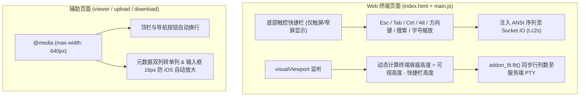

# Web Terminal 移动端适配计划

针对手机与平板浏览器（iOS Safari、Android Chrome），重点解决**软键盘遮挡终端光标**、**手机键盘缺少特殊功能键**（`Esc`/`Tab`/`Ctrl`/方向键）、**窄屏终端列数过少**以及**附属页面窄屏溢出**四大核心痛点。

## 架构与交互概览

---

## 一、Web 终端核心适配（[index.html](file:///source/build-data/client/index.html) & [main.js](file:///source/build-data/client/main.js)）

### 1. 软键盘防遮挡（`visualViewport` 同步）
- **现状问题**：当前使用 `height: 100dvh` 和 `window.resize`。在 iOS Safari 及部分 Android 浏览器上，弹出软键盘不会改变 `100dvh`，软键盘会直接盖住终端下半部分（遮挡光标和命令行提示符），且页面容易被意外上下滚动。
- **改造方案**：
  - 监听 `window.visualViewport` 的 `resize` 与 `scroll` 事件。
  - 将终端外层容器高度动态设为 `visualViewport.height - toolbarHeight`，并固定 `offsetTop`，在软键盘弹出/收起时自动触发防抖 `addon_fit.fit()`，确保光标始终停留在软键盘正上方。
  - 为 `body` 增加 `overscroll-behavior: none;` 与 `touch-action: manipulation;`，阻止移动端下拉刷新和橡皮筋回弹干扰终端滚动。

### 2. 触屏虚拟功能键栏（Touch Accessory Bar）
- **现状问题**：手机软键盘没有 `Esc`、`Tab`、`Ctrl`、`Alt` 和方向键，无法正常操作 `agy` TUI、`vim`、命令补全或中断进程（`Ctrl+C`）。
- **改造方案**：
  - 在终端底部（软键盘上方）增加一条单行可横向滑动的快捷按键栏（桌面端鼠标环境默认隐藏，可通过 `@media (pointer: coarse)` 或屏幕宽度检测启用）。
  - **按键布局**：
    - **状态锁定键**：`Ctrl`、`Alt`（点击后高亮激活，与下一次软键盘输入组合成控制字符，如点 `Ctrl` 再按 `c` 发送 `\x03`，再次点击取消激活）。
    - **高频直发键**：`Esc`、`Tab`、`↑`、`↓`、`←`、`→`、`Home`、`End`、`PgUp`、`PgDn`、`|`、`/`、`-`、`~`。
    - **工具按钮**：`Search`（移动端无 `Ctrl+F`，用于唤出搜索框）、`Paste`（从剪贴板粘贴）、`A-` / `A+`（调整字号）。
  - **焦点保持**：所有快捷栏按钮在 `touchstart` / `mousedown` 时调用 `e.preventDefault()`，点击功能键时**不丢失终端输入焦点、不收起软键盘**。

### 3. 移动端字号与列宽优化
- **现状问题**：默认字号在 375px 宽的手机竖屏上仅能容纳约 40 列，`agy` 和常见 CLI 输出容易折行错乱。
- **改造方案**：
  - 初始化时若检测到窄屏（`window.innerWidth < 600`），将初始 `fontSize` 设为 `12`（约可容纳 60+ 列），桌面端保持默认字号不变。
  - 通过快捷栏 `A-` / `A+`（或双指缩放手势）动态修改 `term.options.fontSize`（范围 `10px`–`22px`）并重算 `addon_fit.fit()`。

### 4. 搜索框移动端适配
- **现状问题**：`#search-bar` 固定在右上角且输入框宽度固定 `160px`；输入框字号为 `12px`（iOS Safari 点击小于 `16px` 的输入框会强制放大页面视口）。
- **改造方案**：
  - 窄屏下搜索栏改为顶部左右贴边自适应宽度（`left: 8px; right: 8px;`）。
  - 移动端将 `#search-input` 字号设为 `16px`，避免 iOS 点击搜索时页面被自动放大。

---

## 二、辅助页面响应式适配

| 页面 | 现状问题 | 适配方案 |
| :--- | :--- | :--- |
| **[viewer.html](file:///source/build-data/client/viewer.html)** | 顶栏 `.header` 未换行，窄屏下文件名与 4 个导航按钮挤压溢出；页面左右留白偏大。 | `@media (max-width: 640px)` 下 `.header` 改为上下排列（`flex-wrap: wrap`），缩减外边距与行号槽宽度（`--gutter-width`），优化触屏横向滚动。 |
| **[upload.html](file:///source/build-data/client/upload.html)** | 目标路径输入框 `font-size: 14px` 触发 iOS 自动放大；文件列表项在窄屏下重命名输入框易挤压。 | 窄屏下输入框设为 `16px`；`.header` 与 `.file-summary` 支持自动换行；调大删除与重命名按钮的触控热区（最小 `32px`）。 |
| **[download.html](file:///source/build-data/client/download.html)** | `.metadata-grid` 固定双列（`repeat(2, 1fr)`），手机竖屏下字节数和 UID/GID 易溢出；状态提示栏左右挤压。 | `@media (max-width: 560px)` 下 `.metadata-grid` 改为单列（`1fr`），`.header` 与 `.download-status` 改为自动换行布局。 |

---

## 三、涉及修改的文件清单

- [index.html](file:///source/build-data/client/index.html)：新增底部快捷栏 DOM 与移动端样式、搜索栏响应式样式。
- [main.js](file:///source/build-data/client/main.js)：新增 `visualViewport` 高度同步、快捷栏按键与 `Ctrl`/`Alt` 修饰状态逻辑、移动端初始字号与字号缩放。
- [viewer.html](file:///source/build-data/client/viewer.html)：补充 `@media (max-width: 640px)` 响应式样式。
- [upload.html](file:///source/build-data/client/upload.html)：补充 `@media (max-width: 640px)` 响应式样式与 `16px` 输入框防放大。
- [download.html](file:///source/build-data/client/download.html)：补充 `@media (max-width: 560px)` 单列网格与顶栏换行样式。
- [entry.js](file:///source/build-data/server/entry.js)：移除已完成的 `// TODO: mobile adapt` 注释。

---

## 四、验证计划

- **构建校验**：在临时测试目录中使用 `esbuild` 打包全部前端脚本（复现 `Dockerfile` 中的构建步骤），确保无打包或语法错误。
- **视口与功能仿真验证**：
  - 模拟窄屏视口（`375x667` / `390x844`）及 `visualViewport` 高度变化（模拟软键盘弹出占半屏），确认终端容器高度与 `addon_fit` 行列数自动收缩且不遮挡底部。
  - 验证快捷栏 `Ctrl` 组合键、`Esc`、`Tab`、方向键、字号加减及搜索按钮的序列发送与焦点保持。
  - 检查 `viewer`、`upload`、`download` 三个页面在 `375px` 宽度下无横向溢出。
